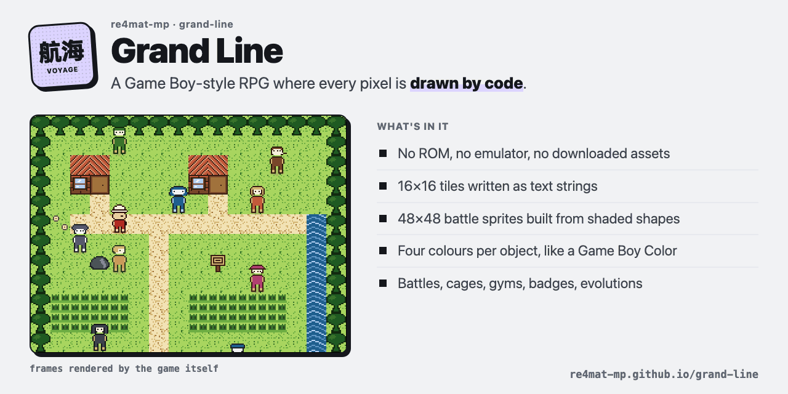

# Grand Line: a Game Boy-style RPG where every pixel is drawn by code

A fan game I built with Claude Code: walk a town, recruit a crew, catch sea beasts in cages, beat two gyms. No ROM,
no emulator, no image files, no game engine. One HTML file draws all of it.

[](https://re4mat-mp.github.io/grand-line/)

**▶ [Play it in the browser](https://re4mat-mp.github.io/grand-line/play/)** · [the start page](https://re4mat-mp.github.io/grand-line/) · works on a phone, with touch controls

It started inside a private dashboard of mine, where a crew of AI agents earns XP for real finished work
(the [agent board](https://github.com/re4mat-mp/agent-dashboard) is a small public version of it). I wanted a
second window where that crew could sail. Two evenings later it was a full RPG: a party of six, 21 species with
evolutions, 40 moves, a type chart, 13 trainers, two gyms with badges, a shop, a save, sound, and 13 maps from the
first town to a desert kingdom.

> **In three sentences.** Everything on screen is generated at load time: 16×16 tiles are written as strings of
> characters, the 48×48 battle sprites are composed from shaded shapes, and every object has its own four-colour
> palette, the way a Game Boy Color does it. The game reads the crew's real levels from a small data file and can
> never write anything back, so playing does not move a single point of work XP. I never trusted a change until I
> had rendered it and looked at the picture, because a canvas game that "runs without errors" can still draw nothing.

## What's in it

| File | What it is |
|---|---|
| [`play/index.html`](play/index.html) | **The game.** One self-contained file, about 6,000 lines of HTML and JavaScript. Open it and play. |
| [`index.html`](index.html) | The start page. |
| [`play/sw.js`](play/sw.js), [`manifest.webmanifest`](play/manifest.webmanifest) | So it installs to a phone's home screen and plays offline. |
| [`media/`](media/) | The GIF above and the start page's pictures, all frames the game drew itself. |

Controls: arrows to move, **Z** to talk and confirm, **X** for the menu, **M** to mute. On a phone, a d-pad and A/B.

## The rules it is built on

1. **Nothing downloaded.** No sprite sheets, no fonts, no sounds from anywhere. Tiles, characters, the font, the
   battle sprites and the beeps are all generated by the code in the file.
2. **Four colours per object.** Each sprite and tile carries its own palette of four, like real Game Boy Color
   hardware. A new place (snow, desert, a ship's deck) costs four hex values, not new art.
3. **Small art by hand, big art by shapes.** A 16×16 tile is a hand-written grid of characters. A 48×48 battle
   sprite is built from shaded circles and polygons, because drawing 48 rows of 48 characters by hand is where
   lopsided monsters come from.
4. **DS resolution, Game Boy pixels.** The screen is 256×192 and scales up in whole steps only, so a pixel stays a
   square on any screen, including a phone's (it measures device pixels, not CSS ones).
5. **Two kinds of "level", never mixed.** A fighter's level in the game is earned by battling. A crew member's level
   comes from the data file. Same character, two numbers, on purpose.
6. **The world is never locked by work.** An early version only let you sail on once the crew had earned enough XP.
   I took it out: you should be able to move freely in the world, and the crew's numbers are flavour, never a lock.

## How I built it with Claude

I described the game I wanted in plain words and Claude Code wrote it, in short rounds: one island, one system, or
one graphics pass at a time, each one a commit. The model was **Claude Opus 5**; every commit on the game carries it
as co-author. This public copy was prepared with **Claude Opus 5.5**.

What made it work was not the prompts, it was how each round was checked:

- **Every state is a URL.** The game reads a debug hash, like `#map=shells,x=6,y=6,battle=menu`, and steps the world
  to that exact state, so any screen can be opened and photographed without playing up to it.
- **Look before calling it done.** A small tool renders the page off-screen and saves a picture, and every change
  was looked at, not reasoned about. A sheet that shows every character side by side caught things that were
  invisible when they were scattered across a map.
- **Tests that guard the rules.** A smoke suite fails the build if the game file ever mentions the files that write
  XP, so "playing never moves work XP" is enforced, not promised.

## Mistakes included

- **The off-screen renderer lies about animation.** In a hidden web view, `requestAnimationFrame` and timers are
  suspended, so anything that paints on a timer came back as a blank picture with no error. The fix: the game paints
  once immediately at start, and the debug hash steps the world by hand instead of waiting.
- **Resizing the canvas wipes it.** Setting `canvas.width` clears the canvas, so a resize that didn't repaint in the
  same turn left a black screen.
- **Text runs off the edge.** Almost every UI bug was a fixed-width text column overflowing: at 6 pixels per letter,
  anything past about 24 characters falls off the box. The fix is always the same: right-align it or split it.
- **A `#` in a file path.** The desktop window loaded `game.html%23fresh=1`, a file that doesn't exist, because a
  file URL percent-encodes the `#`. The fragment has to be added separately.

## Run it locally

```bash
git clone https://github.com/re4mat-mp/grand-line && cd grand-line
open play/index.html          # Linux: xdg-open, Windows: start
```

No build step and no server needed. To install it on a phone, open the [play page](https://re4mat-mp.github.io/grand-line/play/)
and choose "Add to Home Screen".

---

<sub>An unofficial, non-commercial fan game. One Piece and its characters belong to Eiichiro Oda, Shueisha and Toei
Animation; this project is not affiliated with them and uses none of their artwork. Every pixel is drawn by code.</sub>
